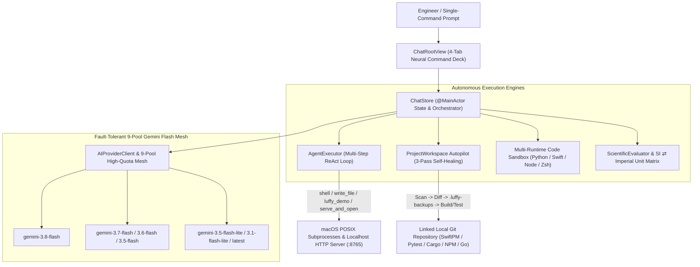

# LuffyOS v3.0 — Native macOS Autonomous AI Engineering Workbench & Self-Healing Code Agent

[](https://github.com/Yuvi1007/LuffyOS)
[](https://github.com/Yuvi1007/LuffyOS)
[](https://yuvi1007.github.io/LuffyOS/)
[](https://yuvi1007.github.io/LuffyOS/)

> **🌐 Live Interactive Architecture Showcase:** **[https://yuvi1007.github.io/LuffyOS/](https://yuvi1007.github.io/LuffyOS/)**

**LuffyOS** (`LuffyDesktop`) is a native macOS developer workbench and autonomous engineering agent written in **~4,300 lines of Swift (`SwiftUI` + `AppKit`)**. It combines a **9-Pool Fault-Tolerant Gemini Quota Mesh Router**, an **Autonomous Multi-Step ReAct Execution Harness (`AgentExecutor`)**, a **Closed-Loop Self-Healing Codebase Autopilot**, and a **4-Runtime Local Code Execution Sandbox** (`Python 3`, `Swift`, `Node.js`, `Zsh`).

---

## System Architecture



---

## Core Engineering Highlights

### 1. Fault-Tolerant 9-Pool Gemini Flash Quota Mesh (`GeminiClient`)
* **Automatic `HTTP 429` Failover**: Dynamically load-balances and fails over across 9 distinct Gemini Flash model quota pools (`gemini-3.8-flash`, `gemini-3.7-flash`, `gemini-3.6-flash`, `gemini-3.5-flash`, `gemini-3.5-flash-lite`, `gemini-3.1-flash-lite`, `gemini-3-flash-preview`, `gemini-flash-latest`, `gemini-flash-lite-latest`).
* **Smart Grounding Fallback**: Detects `google_search` tool-grounding quota exhaustion and transparently retries without grounding so requests never fail due to free-tier tool limits.
* **Keychain & Local Credential Isolation**: Stores API credentials in macOS Keychain (`SecItemAdd`/`SecItemCopyMatching`) and `0600`-permissioned Application Support storage (`KeychainStore`) with regex secret redaction before sending repository context.

### 2. 1-Command Autonomous ReAct Execution Engine (`AgentExecutor`)
* **Multi-Step Tool Loop**: Executes up to 8 autonomous reasoning-and-action steps per prompt inside `~/LuffyWorkspace`.
* **Zero-Escaping `<luffy_demo>` Streaming Protocol**: Solves LLM JSON-escaping failures on large HTML/JS payloads by extracting raw `<luffy_demo>...</luffy_demo>` blocks, writing `~/LuffyWorkspace/live-demo/index.html`, booting a background HTTP server on `127.0.0.1:8765`, and launching the user's default macOS browser via `NSWorkspace`.

### 3. Closed-Loop Self-Healing Codebase Autopilot (`ProjectWorkspace`)
* **Automatic Build/Test Detection**: Inspects linked local folders for `Package.swift`, `package.json`, `pyproject.toml`, `pytest.ini`, `Cargo.toml`, `go.mod`, `Makefile`, `CMakeLists.txt`, and `pubspec.yaml`.
* **Path-Traversal Hardening & Atomic Backups**: Validates all proposed file paths against symlink/parent-directory traversal and snapshots modified files into `.luffy-backups/<timestamp>/` before applying changes.
* **Iterative Compiler/Test Repair**: Runs the project's test suite via asynchronous `Process` pipes and feeds compiler/test failures back into the model for up to 3 automated repair passes.

### 4. 4-Runtime Local Code Sandbox & Scientific Matrix
* **Live Code Sandbox (`CodeSandboxLabView`)**: Executes `Python 3`, `Swift`, `Node.js`, and `Zsh` scripts locally with real-time `stdout`/`stderr` telemetry and 1-click **"Run in Sandbox"** on any assistant code block.
* **Recursive-Descent Scientific Evaluator (`ScientificEvaluator`)**: Zero-dependency expression parser supporting `sin`, `cos`, `tan`, `sqrt`, `log`, `ln`, `exp`, exponentiation, physical constants (`pi`, `e`, `g`, `c`, `k_B`, `q_e`), and precision SI ⇄ Imperial unit conversion across 8 engineering categories.

---

## Building & Running on macOS

### Prerequisites
* macOS 13.0+ (Ventura, Sonoma, Sequoia)
* Xcode Command Line Tools (`swift 5.9+`)

### Build & Install `.app` Bundle
```bash
git clone https://github.com/Yuvi1007/LuffyOS.git
cd LuffyOS
./build-app.sh
open "$HOME/Applications/Luffy Companion.app"
```

---

## License
MIT License © 2026 Yuvraj Sharma
