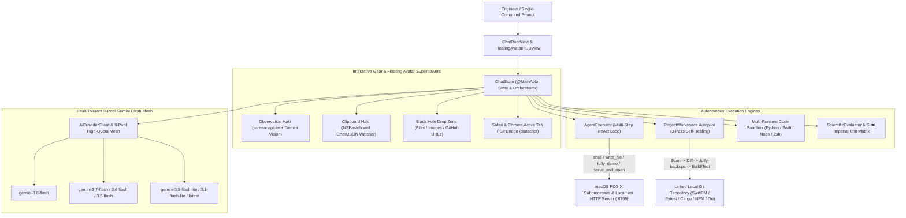

# LuffyOS v6.0 — Universal J.A.R.V.I.S. AI Companion (macOS Native App + Cross-Platform Chrome Extension)

[-00e5ff?style=for-the-badge&logo=apple)](https://github.com/Yuvi1007/LuffyOS/releases)
[](https://github.com/Yuvi1007/LuffyOS)
[](https://yuvi1007.github.io/LuffyOS/)
[](https://yuvi1007.github.io/LuffyOS/)

> **🌐 Live Interactive Architecture Showcase:** **[https://yuvi1007.github.io/LuffyOS/](https://yuvi1007.github.io/LuffyOS/)**
> **📦 1-Click Downloads (No Terminal Required):** **[Download `LuffyOS.dmg` (macOS) & `Luffy-Everywhere-Chrome-Extension.zip` (Windows/Mac/Linux)](https://github.com/Yuvi1007/LuffyOS/releases)**

---

## 🌍 1-Click Install for Everyone (Mac, Windows & Linux)

| Platform | Package | How to Use in 10 Seconds |
| :--- | :--- | :--- |
| **🍎 macOS (Native App)** | [`LuffyOS-v6.0-Universal.dmg`](https://github.com/Yuvi1007/LuffyOS/releases) | Download `.dmg` from Releases $\to$ open **`Luffy Companion.app`**. Press **`⌘2`** to toggle the floating J.A.R.V.I.S. HUD, **`⌥Space`** to show/hide Full-Body Luffy, or **`⌘1`** for the **JARVIS OMNI-OS** Command Deck. |
| **🪟 Windows / 🐧 Linux / 🍎 Mac Browser** | [`chrome-extension/`](chrome-extension/) (`Luffy-Everywhere-Chrome-Extension.zip`) | Open `chrome://extensions` $\to$ enable **Developer Mode** $\to$ click **Load unpacked** and select `chrome-extension/`. Press **`Alt + L`** on any webpage (YouTube, Gmail, LinkedIn, LeetCode) to summon Luffy! *(Works out-of-the-box in Zero-Key Mode, Local Ollama, or Gemini Mesh).* |
| **🌐 Any Phone / Tablet / Browser** | [https://yuvi1007.github.io/LuffyOS/](https://yuvi1007.github.io/LuffyOS/) | Open directly in any browser to explore the live interactive architecture & simulator. |

**LuffyOS** (`LuffyDesktop` + `chrome-extension`) is a universal J.A.R.V.I.S.-style AI companion and autonomous engineering OS written in **~5,500 lines of Swift (`SwiftUI` + `AppKit`) and Manifest V3 JavaScript**. It combines a **9-Pool Fault-Tolerant Gemini Quota Mesh Router**, a **Full-Body Unclipped Draggable Luffy Avatar (`FloatingAvatarHUDView`)** with **9 Universal J.A.R.V.I.S. Superpowers**, **Spoken Morning Briefings**, **1-Click `~/Downloads` File Auto-Organizer (`Shambles`)**, **Native Apple Notes & Reminders Sync**, **Active Job $\to$ ATS Resume Matcher**, **Exam Cram Hologram Builder**, and a **Persistent Second-Brain Memory Vault**.

---

## System Architecture



---

## Core Engineering Highlights

### 1. Interactive Gear-5 Floating Avatar HUD (`FloatingAvatarHUDView` & `InteractiveAvatarPanel`)
Hosted inside a custom non-blocking, key-capable floating `NSPanel` at the bottom-right of macOS:
* **👁️ Observation Haki (1-Click Screen Vision)**: Snapshots the active screen via `/usr/sbin/screencapture`, resizes via `sips`, and sends a multimodal `inline_data` payload to Gemini Vision (`gemini-3.8-flash`) to debug visible IDE errors, terminal crashes, or architecture diagrams directly inside Luffy's floating holographic speech bubble.
* **📋 Clipboard Haki (`NSPasteboard` Watcher)**: Continuously monitors `NSPasteboard.general.changeCount`. Automatically badges the floating avatar when stack traces (`Traceback`, `error:`, `npm ERR!`), JSON, cURL commands, or GitHub URLs are copied, enabling 1-click root-cause fixes or type generation.
* **🌀 Black Hole Drag-and-Drop Zone**: Drop any GitHub URL, project folder, source file, PDF, or UI screenshot directly onto the floating Luffy avatar to auto-clone, build a live interactive dashboard, or generate UI code.
* **🌐 Active Browser & Git Bridge**: Queries Safari/Chrome via `osascript` to grab the active tab URL/title—auto-cloning and building a live demo if you're viewing a GitHub repository, or summarizing technical documentation.
* **🎙️ Push-to-Talk Voice Execution & Mini Spotlight Pill**: Speak or type 1-line commands directly into the floating avatar HUD without opening the main window.
* **⚡ Dev-Ops Port & Process Guardian**: 1-click telemetry scan of developer ports (`3000, 5173, 8000, 8080, 8765`), top CPU processes, and 1-click stuck-port cleanup.

### 2. Fault-Tolerant 9-Pool Gemini Flash Quota Mesh (`GeminiClient`)
* **Automatic `HTTP 429` Failover**: Dynamically load-balances and fails over across 9 distinct Gemini Flash model quota pools (`gemini-3.8-flash`, `gemini-3.7-flash`, `gemini-3.6-flash`, `gemini-3.5-flash`, `gemini-3.5-flash-lite`, `gemini-3.1-flash-lite`, `gemini-3-flash-preview`, `gemini-flash-latest`, `gemini-flash-lite-latest`).
* **Smart Grounding Fallback**: Detects `google_search` tool-grounding quota exhaustion and transparently retries without grounding so requests never fail due to free-tier tool limits.
* **Keychain & Local Credential Isolation**: Stores API credentials in macOS Keychain (`SecItemAdd`/`SecItemCopyMatching`) and `0600`-permissioned Application Support storage (`KeychainStore`) with regex secret redaction.

### 3. 1-Command Autonomous ReAct Execution Engine (`AgentExecutor`)
* **Multi-Step Tool Loop**: Executes up to 8 autonomous reasoning-and-action steps per prompt inside `~/LuffyWorkspace`.
* **Zero-Escaping `<luffy_demo>` Streaming Protocol**: Solves LLM JSON-escaping failures on large HTML/JS payloads by extracting raw `<luffy_demo>...</luffy_demo>` blocks, writing `~/LuffyWorkspace/live-demo/index.html`, booting a background HTTP server on `127.0.0.1:8765`, and launching the user's default macOS browser.

### 4. Closed-Loop Self-Healing Codebase Autopilot (`ProjectWorkspace`)
* **Automatic Build/Test Detection**: Inspects linked local folders for `Package.swift`, `package.json`, `pyproject.toml`, `pytest.ini`, `Cargo.toml`, `go.mod`, `Makefile`, `CMakeLists.txt`, and `pubspec.yaml`.
* **Path-Traversal Hardening & Atomic Backups**: Validates all proposed file paths against symlink/parent-directory traversal and snapshots modified files into `.luffy-backups/<timestamp>/` before applying changes.
* **Iterative Compiler/Test Repair**: Runs the project's test suite via asynchronous `Process` pipes and feeds compiler/test failures back into the model for up to 3 automated repair passes.

---

## Building & Running on macOS

```bash
git clone https://github.com/Yuvi1007/LuffyOS.git
cd LuffyOS
./build-app.sh
open "$HOME/Applications/Luffy Companion.app"
```

---

## License
MIT License © 2026 Yuvraj Sharma
